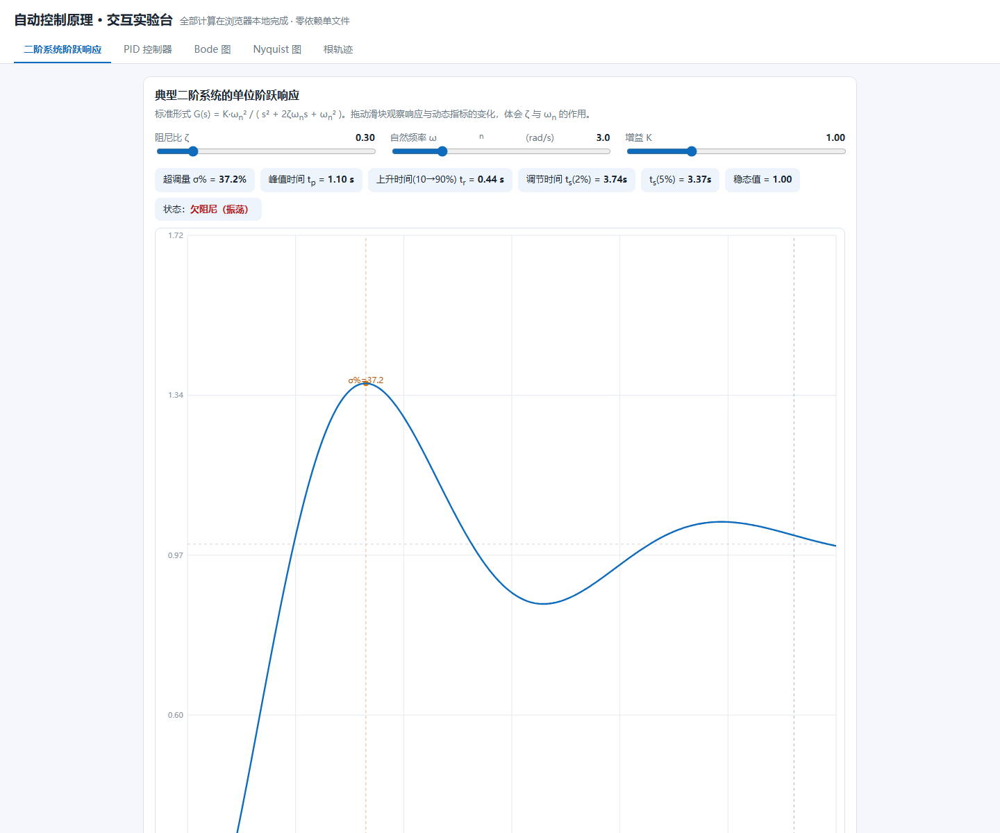
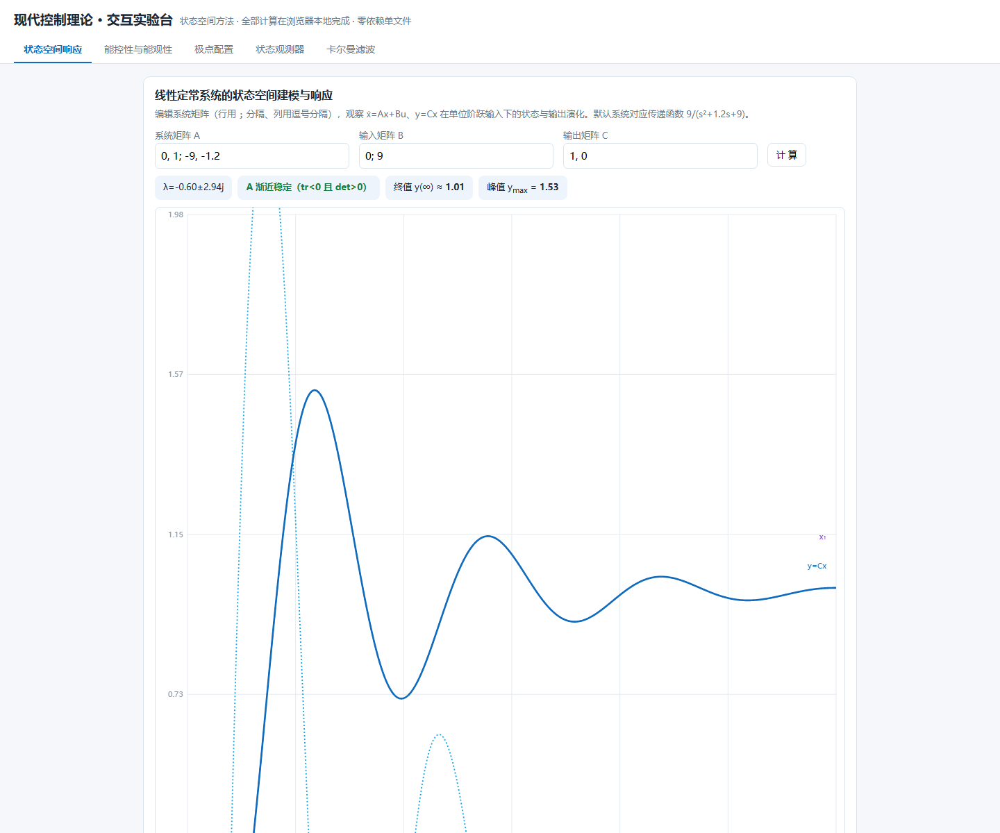
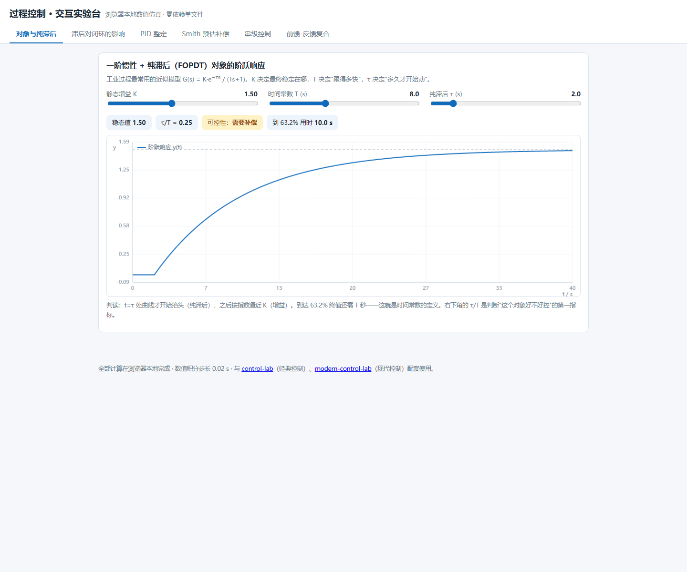
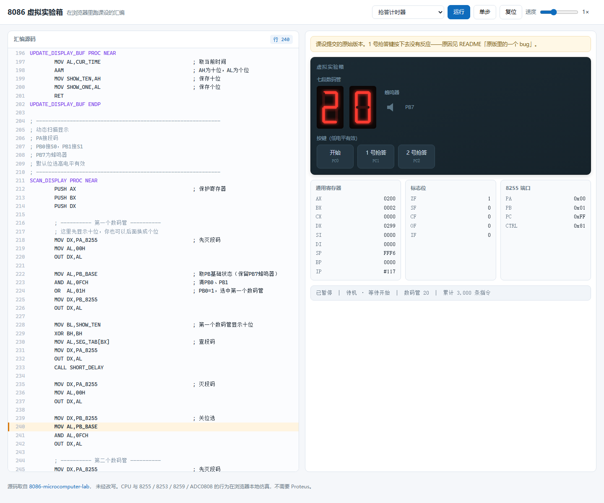

# 你好，我是 f1sh 👋

天津，自动化专业在读。我喜欢用代码解决自己遇到的真实问题——这里的每个项目都始于「我自己需要这个」。

四个实验台都能直接打开：拖滑块、按按钮、看波形，不用装环境，不用 clone。

<table>
  <tr>
    <td width="50%" align="center">
      
       <b>经典控制</b> · 阶跃响应 / PID / Bode / Nyquist / 根轨迹
    </td>
    <td width="50%" align="center">
      
       <b>现代控制</b> · 状态空间 / 能控能观 / 极点配置 / 卡尔曼滤波
    </td>
  </tr>
  <tr>
    <td width="50%" align="center">
      
       <b>过程控制</b> · 纯滞后 / Smith 预估 / 串级 / 前馈-反馈
    </td>
    <td width="50%" align="center">
      
       <b>微机原理</b> · 8086 CPU + 8255/8253/8259/ADC0808，单步执行
    </td>
  </tr>
</table>

## 一条从理论走到引脚的线

自动化这个专业有意思的地方在于：同一套东西可以从传递函数一路做到芯片引脚上。课上学的内容，我都做成了能跑起来的东西：

- **经典控制** —— [control-lab](https://github.com/Leslieryin/control-lab)：二阶系统阶跃响应、PID、Bode、Nyquist、根轨迹，单文件网页，拖滑块实时看曲线。
- **现代控制** —— [modern-control-lab](https://github.com/Leslieryin/modern-control-lab)：状态空间响应、能控能观判据、Ackermann 极点配置、状态观测器、卡尔曼滤波。
- **过程控制** —— [process-control-lab](https://github.com/Leslieryin/process-control-lab)：一阶加纯滞后对象、Smith 预估补偿、串级控制、前馈-反馈复合控制。
- **微机原理** —— [8086-microcomputer-lab](https://github.com/Leslieryin/8086-microcomputer-lab)：8255+8254 抢答计时器、8253+8259+ADC0808 定时采样，含 Proteus 仿真与重构前后对照。
  - **↳ 在线仿真** —— [8086-emulator-lab](https://github.com/Leslieryin/8086-emulator-lab)：把上面两个实验都搬进浏览器，8086 CPU + 8255/8253/8259/ADC0808 仿真，单步执行、看标志位、拖滑块改模拟量，不用装 Proteus。
- **工程基础** —— [database-course-design](https://github.com/Leslieryin/database-course-design)：SQL Server 从建库、约束、连接查询到索引、视图、触发器。

三层控制实验台是网页版的「看得见」，微机和数据库是实打实的「做得出」，最后又把这套课设的汇编直接搬进了浏览器。8253 为什么要拆成 1000×100 两级分频才凑得出 10Hz 中断、纯滞后为什么能让同一套 PID 参数从稳定一路走到发散、外键约束怎么被两个字母 `O` 写成数字 `0` 卡住、抢答器里一处 `JZ`/`JNZ` 写反让 1 号键彻底失效——这些坑都是当时蹲出来的，也都写进对应仓库的 README 了。

## 解决自己的问题

剩下的项目没有统一主题，共同点是：我真的被某件事烦到了。

- 🖼️ **[photo-cleanup-pipeline](https://github.com/Leslieryin/photo-cleanup-pipeline)** —— 两台手机多年的照片混在一起，有字节级重复、HEIC 与「假 JPG」、连拍和截图混杂。七步流水线，先报告后动手，绝不静默删照片
- 🧹 **[windows-disk-cleanup](https://github.com/Leslieryin/windows-disk-cleanup)** —— C 盘告急。分层安全模型（safe / caution / risky），默认只读，回收站和用户数据一律不碰
- 🩺 **[windows-healthcheck](https://github.com/Leslieryin/windows-healthcheck)** —— 只读 PowerShell 诊断脚本集，硬件 / 启动项 / 安全 / 稳定性一键出留档报告
- 📺 **[bili-watcher](https://github.com/Leslieryin/bili-watcher)** —— 随机观影 + 内容总结。只读公开数据，自己实现了 WBI 签名，明确不做自动评论

## 导航与延伸

- 🗺️ **[awesome-automation-zh](https://github.com/Leslieryin/awesome-automation-zh)** —— 自动化专业开源资源导航：控制理论 / 嵌入式 / 机器人 / 电赛·智能车·RoboMaster，每条附点评和从大一到大四的学习路径
- 📱 **开源二次开发** —— 为 [ArkPlots](https://github.com/Leslieryin/ArkPlots)（明日方舟剧情管理工具）适配 Android 纯离线版（Capacitor，包体积 45MB→9MB），并向上游提交了安全加固 PR（更新包 SHA-256 校验、本地服务跨站防护）
- 🎨 **[comfyui-teaching-kit](https://github.com/Leslieryin/comfyui-teaching-kit)** —— ComfyUI 教学工作流，专注本地 GGUF 量化模型的显存友好方案

## 仓库一览

| 仓库 | 是什么 | 在线打开 |
| --- | --- | --- |
| [leslieryin.github.io](https://github.com/Leslieryin/leslieryin.github.io) | 全部作品的入口页 | [在线](https://leslieryin.github.io/) |
| [control-lab](https://github.com/Leslieryin/control-lab) | 经典控制理论交互实验台，单文件 HTML | [在线](https://leslieryin.github.io/control-lab/) |
| [modern-control-lab](https://github.com/Leslieryin/modern-control-lab) | 现代控制理论交互实验台，手写矩阵运算 | [在线](https://leslieryin.github.io/modern-control-lab/) |
| [process-control-lab](https://github.com/Leslieryin/process-control-lab) | 过程控制实验台：纯滞后 / Smith 预估 / 串级 / 前馈 | [在线](https://leslieryin.github.io/process-control-lab/) |
| [8086-emulator-lab](https://github.com/Leslieryin/8086-emulator-lab) | 浏览器里跑课设汇编的 8086 虚拟实验箱 | [在线](https://leslieryin.github.io/8086-emulator-lab/) |
| [8086-microcomputer-lab](https://github.com/Leslieryin/8086-microcomputer-lab) | 8086 汇编课程设计原件，含 Proteus 工程 | — |
| [database-course-design](https://github.com/Leslieryin/database-course-design) | SQL Server 数据库设计：医疗挂号与租车 | — |
| [photo-cleanup-pipeline](https://github.com/Leslieryin/photo-cleanup-pipeline) | 手机照片整理七步流水线 | — |
| [windows-disk-cleanup](https://github.com/Leslieryin/windows-disk-cleanup) | Windows 磁盘清理，分层 + 默认只读 | — |
| [windows-healthcheck](https://github.com/Leslieryin/windows-healthcheck) | Windows 一键体检，只读诊断 | — |
| [bili-watcher](https://github.com/Leslieryin/bili-watcher) | B 站随机观影与内容总结 | — |
| [awesome-automation-zh](https://github.com/Leslieryin/awesome-automation-zh) | 自动化专业开源资源导航 | — |
| [comfyui-teaching-kit](https://github.com/Leslieryin/comfyui-teaching-kit) | ComfyUI 教学工作流 | — |
| [ArkPlots](https://github.com/Leslieryin/ArkPlots) | fork：Android 纯离线版适配 + 安全加固 PR | — |

## 技术栈

`Python` `TypeScript` `React` `Capacitor` `PowerShell` `8086 Assembly` `T-SQL` `ComfyUI`

## 联系

- 作品入口：[leslieryin.github.io](https://leslieryin.github.io/)
- 问题与建议：直接在本仓库开 Issue

---

*大部分项目在与 AI 结对的过程中完成——我更愿意把精力放在想清楚要解决什么问题上。*
